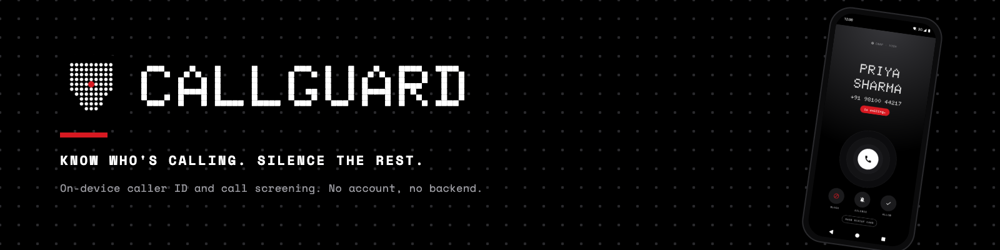

CallGuard shows who is calling, names the source of that name, and holds back the calls and texts you did not ask for. It is a phone and SMS app for Android in India.

[](https://github.com/heyaibi/callguard/actions/workflows/ci.yml)

## What it does

- Resolves a caller's name from the carrier's CNAP (Calling Name Presentation) signal, then from your phonebook, then from names CallGuard has learned on this phone, and labels each name with the source that produced it.
- Screens incoming calls before they ring with an allow list, a block list, contacts-only blocking (on by default once Contacts access is granted), and a spam score computed on the device.
- Holds back texts the same way, and Ignore mode moves messages from unknown senders into a Quiet Inbox.
- Works as the default phone app (incoming and in-call screens, keypad, contacts, one merged recents list) and as the default SMS app (conversations, and reply from the notification).
- Shows a caller card over WhatsApp when you grant notification access and the overlay permission.
- Keeps names, calls, and messages on the phone. There is no backend, no account, and no INTERNET permission in the manifest.

## Why it exists

An unknown number in India arrives as digits, and a name comes only when the carrier sends one with the call. CallGuard uses that name when it arrives, fills the gap from the phone itself, and gives you one place to decide which unknown callers and senders get through.

## Requirements

- JDK 21. CI builds on Temurin 21.
- Android SDK Platform 37, which is the `compileSdk` in `app/build.gradle.kts`. Point Gradle at the SDK with `ANDROID_HOME` or an `sdk.dir` line in `local.properties`.
- A device or emulator on Android 10 (API 29) or newer, which is the `minSdk`.

## Build and run

```bash
git clone https://github.com/heyaibi/callguard.git
cd callguard
./gradlew :app:assembleDebug
```

The APK is written to `app/build/outputs/apk/debug/app-debug.apk`.

Install it on a connected device or emulator and launch it:

```bash
./gradlew :app:installDebug
adb shell am start -n com.callguard/.MainActivity
```

The app opens on the Guard home screen with no roles held. [Get started](docs/tutorials/get-started.md) covers the permissions and roles to grant next.

## Docs

- [Docs home](docs/index.md): what CallGuard is, and the four ways into these docs.
- [Get started](docs/tutorials/get-started.md): install the app, grant its roles, and reach a working screen.
- [Make CallGuard the default phone app](docs/how-to/set-as-default-dialer.md): take over calls and the in-call screen.
- [Make CallGuard the default SMS app](docs/how-to/set-as-default-sms-app.md): take over texts and conversations.
- [Tune what CallGuard blocks](docs/how-to/tune-blocking-rules.md): choose what silence, ignore, and contacts-only do to a call or text.
- [Manage the allow and block lists](docs/how-to/manage-lists.md): add, remove, and clear numbers on both lists.
- [Cut a release](docs/how-to/cut-a-release.md): tag a version and let the release workflow build the APK.
- [CallGuard settings reference](docs/reference/settings.md): every setting, its default, and what it changes.
- [Permissions and roles reference](docs/reference/permissions-and-roles.md): what each permission and Android role buys the app.
- [Gradle tasks reference](docs/reference/gradle-tasks.md): every task the wrapper exposes, with what it does.
- [How caller identity works](docs/explanation/caller-identity.md): the lookup sources, their order, and their confidence levels.
- [How call screening works](docs/explanation/screening.md): the decision order, the deadline fallback, and what reaches the call log.
- [How the App Bridge works](docs/explanation/app-bridge.md): how a WhatsApp call notification becomes a caller card.
- [Architecture](docs/explanation/architecture.md): packages, data flow, and the platform services the app binds.
- [Testing standard](docs/contributing/testing.md): test types, names, rules, and templates for contributors.
- [Working from an issue](AGENTS.md): scope, branch, verification, and pull request rules for contributors.

## Project layout

```text
callguard/
├── .github/workflows/         ci.yml and release.yml
├── app/
│   ├── src/main/
│   │   ├── java/com/callguard/
│   │   │   ├── bridge/        WhatsApp notification listener, parser, overlay card
│   │   │   ├── call/          dialer, InCallService, in-call UI, ringing
│   │   │   ├── calllog/       merged recents
│   │   │   ├── contacts/      phonebook reads
│   │   │   ├── core/          phone number normalization
│   │   │   ├── data/          SQLite store, repositories, seed data
│   │   │   ├── identity/      lookup sources and the resolution policy
│   │   │   ├── messaging/     SMS receivers, filter policy, conversations
│   │   │   ├── prefs/         settings store
│   │   │   ├── screening/     CallScreeningService and screening policy
│   │   │   ├── spam/          spam scoring
│   │   │   └── ui/            Compose screens, navigation, theme, formatting
│   │   ├── assets/            bundled.json: business and spam numbers
│   │   └── res/               theme, fonts, launcher icons
│   └── src/test/java/         JVM unit tests for the policies and helpers
├── docs/                      tutorials, how-tos, reference, explanation, blueprint
├── store/                     Play Store listing and graphics
├── gradle/libs.versions.toml  version catalog
├── CONTRIBUTING.md            how to build, test, and open a pull request
└── gradlew                    Gradle wrapper 9.7.0
```

## License

Apache-2.0. See [LICENSE](LICENSE). Pull requests are welcome; [CONTRIBUTING.md](CONTRIBUTING.md) has the build, test, and review rules.
