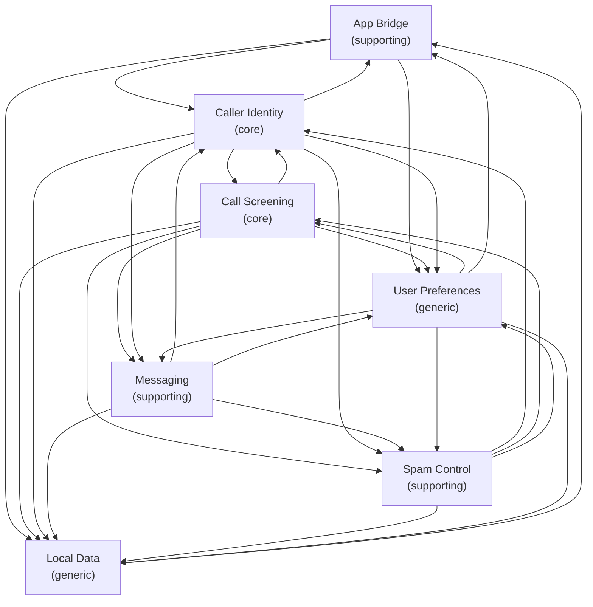

# CallGuard Product Domain Specification

## Purpose & Problem Statement

CallGuard is an Android app that shows who is calling and helps the user avoid unwanted calls and messages. It uses India's CNAP network feature to display the caller's name by default, and falls back to the device phonebook and an on-device cache when the network does not provide a name. It runs fully on the device with no backend or remote database.

## Scope & Boundaries

This specification covers the product's domains, concepts, rules, and behavior. It does not cover implementation technology, storage engines, protocols, or UI layouts. It excludes payment, subscription, chat, and any server-side feature. The app is a personal project and keeps all data on the device.

## Domain Map

<!-- BEGIN GENERATED: domain map -->
### Bounded Contexts
| Bounded Context | Class | Status | Summary |
|---|---|---|---|
| [App Bridge](domains/app-bridge.md) | `supporting` | `settled` | This domain owns caller identity for apps other than the phone dialer, such as WhatsApp. |
| [Call Screening](domains/call-screening.md) | `core` | `settled` | This domain owns what happens when a cellular call arrives or is placed. |
| [Caller Identity](domains/caller-identity.md) | `core` | `settled` | This domain owns resolving a phone number into a display name and the source of that name. |
| [Local Data](domains/local-data.md) | `generic` | `settled` | This domain owns all on-device storage. |
| [Messaging](domains/messaging.md) | `supporting` | `settled` | This domain owns identifying and filtering SMS messages. |
| [Spam Control](domains/spam-control.md) | `supporting` | `settled` | This domain owns detecting and managing spam. |
| [User Preferences](domains/user-preferences.md) | `generic` | `settled` | This domain owns all user settings and lists. |

### Context Map Topology

<!-- END GENERATED: domain map -->

## Navigation Index & Reading Paths

<!-- BEGIN GENERATED: navigation -->
#### Specifications

| Document | Status | Summary |
|---|---|---|
| [Glossary](glossary.md) | `settled` | Ubiquitous language index. |
| [App Bridge](domains/app-bridge.md) | `settled` | This domain owns caller identity for apps other than the phone dialer, such as WhatsApp. |
| [Call Screening](domains/call-screening.md) | `settled` | This domain owns what happens when a cellular call arrives or is placed. |
| [Caller Identity](domains/caller-identity.md) | `settled` | This domain owns resolving a phone number into a display name and the source of that name. |
| [Local Data](domains/local-data.md) | `settled` | This domain owns all on-device storage. |
| [Messaging](domains/messaging.md) | `settled` | This domain owns identifying and filtering SMS messages. |
| [Spam Control](domains/spam-control.md) | `settled` | This domain owns detecting and managing spam. |
| [User Preferences](domains/user-preferences.md) | `settled` | This domain owns all user settings and lists. |

#### Decision Records

| Record | Date | Summary |
|---|---|---|
| [0001 Expand Caller Identity lookup sources](decisions/0001-expand-caller-identity-lookup-sources.md) | `2026-11-05` | Add Google Contacts, Operator Service, and App Profile Name as lookup sources, in that priority order after local contacts and before the on-device cache. |
<!-- END GENERATED: navigation -->
