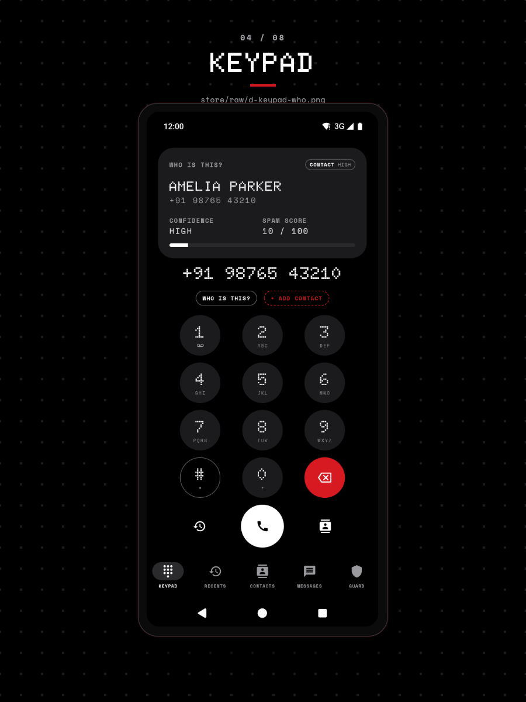

# Why CallGuard asks the network for a name before your phonebook

CallGuard resolves a number through eight sources in a fixed order and takes the first name any of them returns. This page explains why CNAP sits at the top, why your own phonebook comes second, what the order costs, and how a wrong answer is possible.

The chain lives in `ResolutionPolicy` (`app/src/main/java/com/callguard/identity/Resolution.kt`), which sorts the sources by `SourceKind.rank` and stops at the first non-blank name. The source list itself is built in `AppGraph`.

## The constraint that sets everything else

A name is only useful if it arrives before the phone stops ringing. A cellular call gives the app one callback and a few seconds, so resolution has to be local, fast, and unable to fail. Every source therefore answers from data already on the device or already attached to the call, and a source that throws is treated as a source with no name.

That constraint alone rules out an order built on accuracy. The most accurate source might be slow or absent, and a late name is worth nothing.

## The order

| Rank | Source | Trust | What it knows | State in this build |
|---|---|---|---|---|
| 1 | CNAP | network | The name the carrier sent with the call | On, and the only network source that returns names |
| 2 | Local Contact | device | The name you saved | On while `READ_CONTACTS` is granted |
| 3 | Google Contacts | device | Contacts whose raw contact belongs to a `com.google` account | Off unless `googleContacts` is on |
| 4 | Operator Service | network | A name from the operator's own API or USSD | Unavailable; `isAvailable()` returns `false` |
| 5 | App Profile | learned | A name read from a messaging app's profile text | On; reads only entries the bridge learned |
| 6 | On-device cache | learned | A name learned from a past call or text | On |
| 7 | Bundled database | bundled | Published business and spam numbers | On, version 1 |
| 8 | Online lookup | online | A remote name service | Off unless `onlineLookup` is on; returns no name because there is no endpoint |

The ranking comes from decision record [0001 Expand Caller Identity lookup sources](../blueprint/decisions/0001-expand-caller-identity-lookup-sources.md), which added ranks 3, 4 and 5 to an earlier five-source chain on the condition that every source stays on the device or stays opt-in.

## Why CNAP is first

CNAP costs nothing to read. The name arrives attached to the call, so the answer is ready at the moment the call is screened. It also covers the case the app exists for: a number that was never saved, never called back, and belongs to a business the user has no history with. No local source can answer that.

The cost is that the network's name wins over the one you saved. If the carrier labels a number with the business that owns it, and the user saved that number as the name of a person who works there, the card shows the carrier's label. CallGuard accepts this because the alternative order (contacts first) would leave the unsaved-call case unanswered, which is the case the app is for.

A name from the network is only trusted when the presentation flag says allowed. `trustedCnapName` drops the name when `callerDisplayNamePresentation` is anything other than `PRESENTATION_ALLOWED`, so a restricted or withheld presentation yields no name rather than a placeholder.

CNAP also covers only part of the traffic. When a call arrives with no name, resolution falls to the next rank, and the display for a call with no name reads `UNKNOWN`.

## Why the phonebook is second

The phonebook holds names the user wrote. For anyone the user knows, that is the name they expect to see, and it beats anything the carrier or the app could produce. Reading it is a single `PhoneLookup` query by E.164, so it costs one provider call.

Its weakness is that it depends on a permission. `LocalContactSource.isAvailable()` returns false without `READ_CONTACTS`, and the policy then skips the rank without an error. The same degradation reaches further: `AppGraph.effectiveSettings()` forces `contactsOnly` off while the permission is missing, so the app does not claim to block unknown callers when it cannot tell a contact from a stranger.

Google Contacts sits at rank 3, behind the local phonebook and ahead of every learned name. It is still a user-authored address book, so it keeps the trust of a contact, but it needs two conditions before it answers: the `googleContacts` switch and a raw contact whose account type is `com.google`. A contact saved only to the device SIM never matches, which is why the source sits behind the plain phonebook even when enabled.

## Why learned names come after the address book

A learned name is the app's own memory, and it is only as good as what the app happened to see. The cache keeps the name from a previous call or text, so it answers instantly for a repeat caller and cannot answer at all for a stranger.

Two sources read that cache, and the split matters:

- `CacheSource` reads the entry only when its origin is not `app:`, so a name is used at rank 6 only if a call or a text produced it.
- `AppProfileSource` reads the entry only when its origin is `app:<package>`, and only while `bridgeApps[<package>]` is true.

Turning off WhatsApp under APP BRIDGE therefore stops a name learned from WhatsApp from being used, without deleting the entry. Turning it back on restores the name. That behavior is the reason the two readers exist rather than one cache lookup with a filter.

The bundled database comes after the learned cache because it is static. It is right about published business numbers, which is exactly the name a user wants for a bank or a courier line, and it is silent about everything else. It ships as `app/src/main/assets/bundled.json` and its version is shown in Settings.

## Why online lookup is last

Placing online lookup at rank 8 means an opt-in remote call happens only after every local source has failed. It also means the result can never override a name the device already knows, which keeps the phonebook off the network. The source is present, the switch works, and the lookup currently returns no name because the app has no backend and does not declare the `INTERNET` permission.

## What the order costs

- A wrong name from the network beats a right name from the phonebook. The design accepts that to serve unsaved callers.
- There is no scoring. The policy takes the first non-blank answer and stops, so it cannot express a source that is usually right but occasionally wrong. A weighted score would be harder to test and harder to explain to a user looking at a wrong name.
- Confidence describes the source, not the answer. A contact name is `HIGH` because of where it came from, even when the contact entry itself is stale. The four levels are `HIGH` for the three network and device sources, `MEDIUM` for operator, app profile and bundled, and `LOW` for the cache and online lookup.
- An unknown name is a normal result. `resolve` never throws, never returns null, and reports `SourceKind.NONE` with `Confidence.NONE` when nothing answers, so callers do not need a separate error path.

## What a user sees

The caller ID card shows the name, or `UNKNOWN`, then the formatted number, the source label and the confidence, and the spam score when the number is likely spam. The Settings screen lists the same eight sources in the same order, with nothing to reorder. See the [settings reference](../reference/settings.md) for the switches on those rows.

The keypad runs the same chain before you dial, above the number you typed:

## Related

- [Caller Identity domain specification](../blueprint/domains/caller-identity.md) for the product rules this chain implements.
- [Why screening works the way it does](screening.md) for how the resolved name changes what happens to the call.
