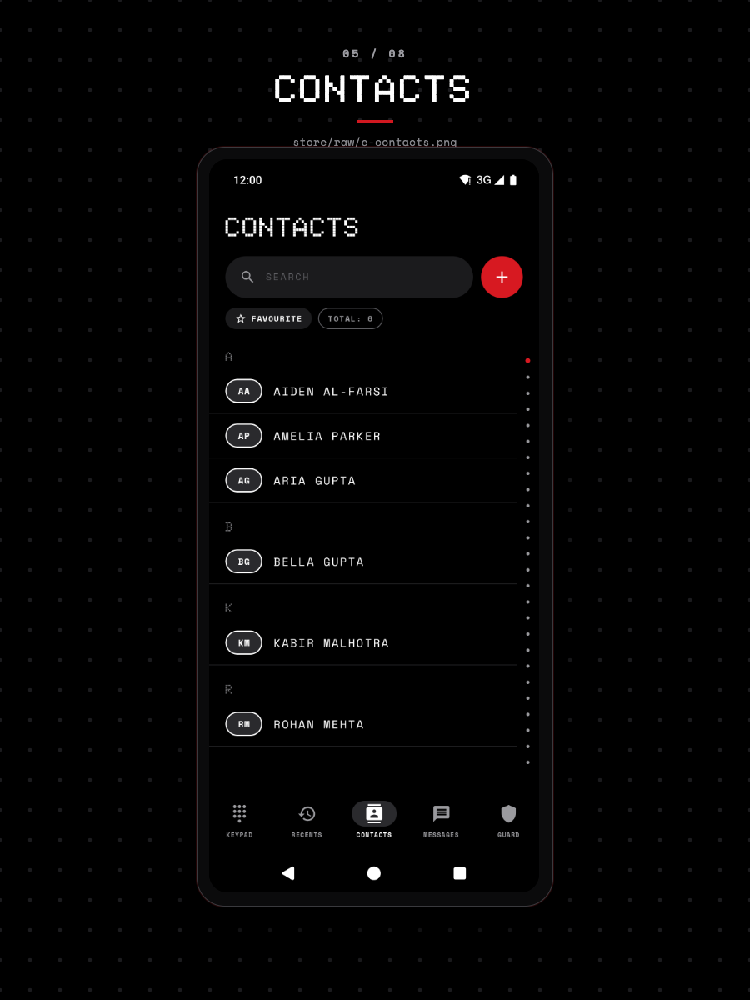

# Manage the allow and block lists

Numbers on the allow list always ring and notify, and numbers on the block list never do. You manage both from the **Guard** tab: scroll to **LISTS**, then tap **ALLOW / BLOCK LISTS**. The change applies to the next call or text.

## Add a number

1. Open the **Guard** tab and scroll to **LISTS**, then tap **ALLOW / BLOCK LISTS**.
2. Pick **ALLOW** or **BLOCK** at the top. Each segment shows its count, and the line under it reads "ALWAYS RING & TEXT THROUGH" or "NEVER RING, NEVER TEXT".
3. Tap the red round button next to the search field.
4. In the **ADD NUMBER** dialog, pick the list and type the number or sender ID.
5. Tap **ADD**.

The dialog reports the result above the list: `ADDED +91 98765 43210 TO ALLOW`, or `MOVED ... FROM BLOCK TO ALLOW` when the number was already on the other list.

## What the field accepts

Numbers are normalized to E.164 with India as the default region, so a 10-digit mobile number, a number with a leading 0, a `00` prefix, or a full `+` number all produce the same entry and the row shows the normalized form.

Alphanumeric sender IDs such as `VM-HDFCBK` are stored as typed and upper-cased, and short codes of three to six digits are kept as they are. Both work in either list, because a blocked sender ID is matched the same way a blocked number is.

## Remove a number

Tap the **X** on the row. The number leaves both lists at once, so removing an entry never leaves a stale copy on the other side.

## What wins when a number is on both

The block list is checked first, in both the call and the text policy, so a blocked number loses the protection an allow entry would give it.

You cannot normally create that state. Adding a number to one list removes it from the other, and the list screen tells you it moved the entry.

## What each list overrides

An allow-listed number skips Contacts only, the spam rules, and Silence mode, for calls and texts alike. A block-listed call is rejected with no ring and no notification, and a block-listed text is marked blocked in the Quiet Inbox.

The Contacts screen carries the same state per person:

The block list is also what the screening deadline falls back on, so a blocked number is still rejected when the full decision arrives too late. See [Tune what CallGuard blocks](../how-to/tune-blocking-rules.md).

## Verify

The segment count goes up by one and the new row appears with a name if the number matches a contact. Call from a block-listed number: nothing rings, and the **RECENTS** row carries a **Blocked** tag. Call from an allow-listed number with Contacts only on: it rings.

## Troubleshooting

- **ADD does nothing**: a red line under the field says `ENTER A PHONE NUMBER OR SENDER ID` for text that does not parse, or `ALREADY IN ALLOW` for a duplicate.
- **The listed number looks different from what you typed**: it was normalized, for example a 10-digit Indian mobile number gaining `+91`. It is the same entry.
- **A listed number is not shown**: the search field filters by name and number, so clear it to see the whole list.

## Related

- [Tune what CallGuard blocks](../how-to/tune-blocking-rules.md)
- [Make CallGuard the default SMS app](../how-to/set-as-default-sms-app.md)
