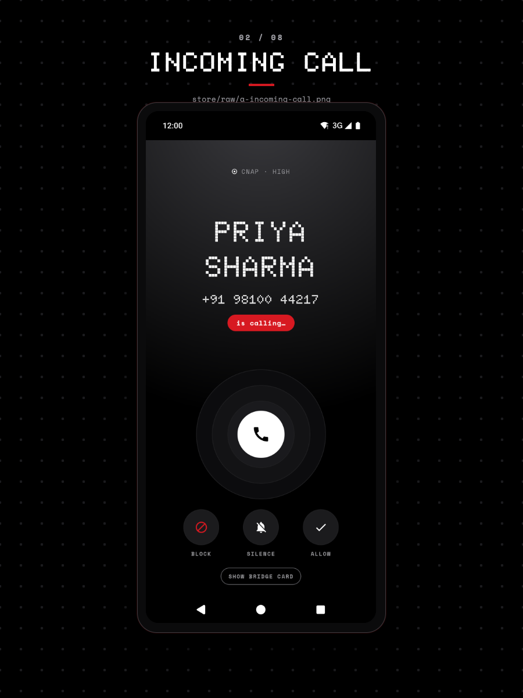
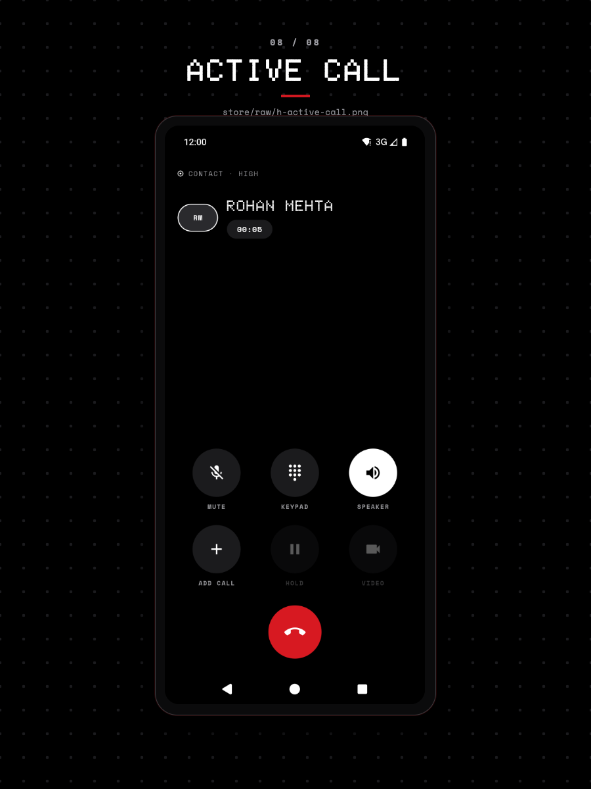

# Make CallGuard the default phone app

Holding the default phone app role (`ROLE_DIALER`) gives CallGuard the in-call screen, the ring, and the keypad launches for every cellular call. You need CallGuard installed; the role comes from a system prompt and grants no access to your data.

## 1. Open the permission rows

Open CallGuard, then scroll the **Guard** tab to **PERMISSIONS**. The **DEFAULT PHONE APP** row reads **NOT HELD** until the role is granted. Its subtitle is "PLACES CALLS & SHOWS THE IN-CALL SCREEN".

## 2. Grant the role

Tap the **DEFAULT PHONE APP** row and accept the Android prompt that names CallGuard. The row re-reads the role when the screen resumes, so it flips to **HELD** on return. The row only opens the prompt while the role is not held, so tapping it again after granting does nothing.

## What the role changes

`CallGuardInCallService` starts receiving every call on the device, contacts' calls included. CallGuard then draws the in-call screen, rings, and keeps the call in progress through a foreground service.

The dialer role also routes launches: `DIAL` and `tel:` links open the CallGuard keypad with the number filled in, and `DialActivity` answers `CALL tel:` and the hardware call button.

One visible change costs you the caller card. While the role is held, no caller ID card and no overlay are posted for incoming calls, because the in-call screen already shows the caller. Blocked-call notices and the call log are unaffected.

That in-call screen also carries the call controls:

## What breaks when you revoke it

Revoking the role hands ringing, the in-call screen, and the `DIAL` launches back to the system phone app. CallGuard stops logging calls it no longer receives, and the caller ID card returns for the calls it still screens. The [permissions reference](../reference/permissions-and-roles.md) lists what each role binds.

Call screening keeps working, because it depends on its own role. To keep or change what gets blocked, see [Tune what CallGuard blocks](../how-to/tune-blocking-rules.md).

## Troubleshooting

- **The row still reads NOT HELD**: the system prompt was dismissed. Tap the row again, or pick CallGuard from Android's own Default apps settings.
- **Incoming calls show no caller card**: expected while the role is held; the in-call screen carries the name.
- **A call does not go through from the keypad**: `CALL_PHONE` is a separate permission; the app asks for it the first time you place a call.

## Related

- [Make CallGuard the default SMS app](../how-to/set-as-default-sms-app.md)
- [Manage the allow and block lists](../how-to/manage-lists.md)
