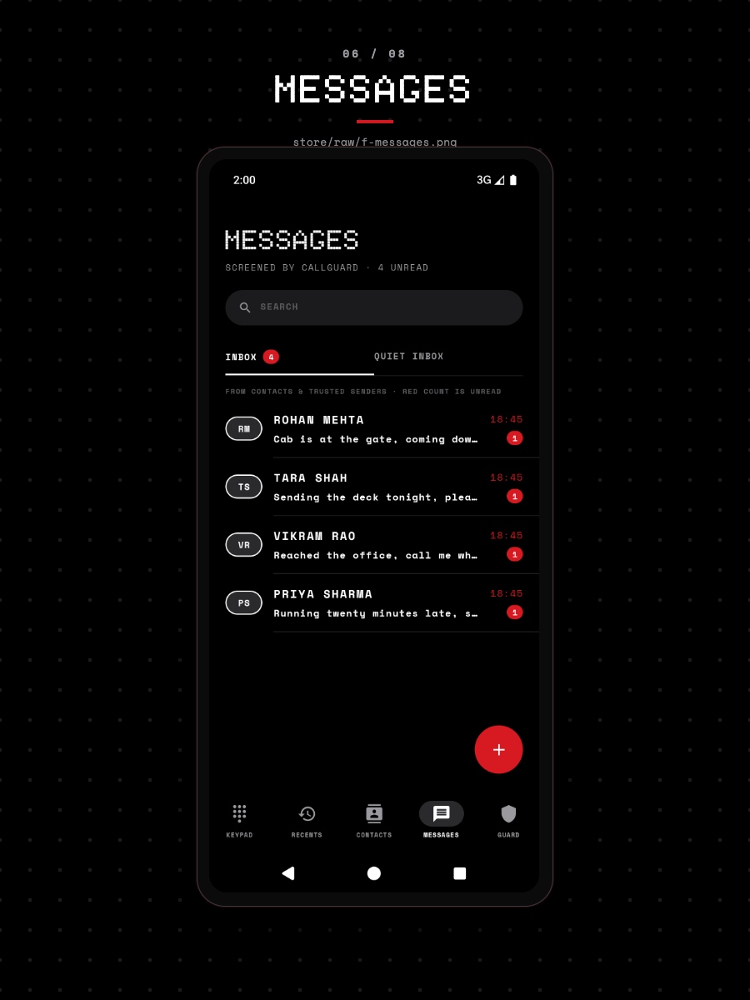

# Make CallGuard the default SMS app

Holding the SMS role (`ROLE_SMS`) is what lets CallGuard store your texts, hold back texts from non-contacts, and send replies. You need CallGuard installed and the call screening role granted separately if you also want call rules; this page covers texts only.

## 1. Open the prompt

Open CallGuard, tap the gear on the Guard screen, and scroll to **PERMISSIONS**. The **DEFAULT SMS APP** row reads **NOT HELD** until the role is granted. Its subtitle is "STORES TEXTS & SENDS REPLIES".

The Messages screen offers the same prompt from its banner, labelled **SET AS DEFAULT SMS APP TO BLOCK TEXTS**. Both routes open the Android role dialog.

## 2. Grant the role

Accept the system prompt that names CallGuard. The row re-reads the role when the screen resumes and flips to **HELD**, and the banner disappears from Messages.

## What the role changes

With the role, `SmsDeliverReceiver` receives each text, stores it in the Android SMS provider, writes a log entry, and notifies according to the outcome: a normal alert for a text from a contact or an allow-listed sender, a silent one when Silence mode applies, and none at all for the Quiet Inbox or a blocked sender.

The Messages screen shows that split: unread counts per thread, **INBOX** for what reached you, and **QUIET INBOX** beside it for what was held back.

Blocking texts depends on the role. Android delivers `SMS_DELIVER` to the default SMS app only, so while another app holds the role CallGuard's `SmsReceiver` only writes a log entry, and the other app shows and alerts for the message. Non-contact blocking, Ignore mode, and Silence mode therefore take effect on texts only while CallGuard is the default.

Replying from a thread uses `SEND_SMS`, which the app requests the first time you send. MMS download is not implemented, so media messages are not fetched.

## Verify

- **PERMISSIONS** shows **DEFAULT SMS APP** as **HELD**.
- The **SET AS DEFAULT SMS APP TO BLOCK TEXTS** banner is gone from Messages.
- With Ignore mode on, a text from a number outside your contacts lands under the **QUIET INBOX** tab with no alert, and **INBOX** does not list it.

## What breaks when you revoke it

Texts go back to whichever app holds the role. CallGuard stops storing new messages, so its threads stop growing and its replies stop working. The Quiet Inbox keeps the messages it already has and receives nothing new.

Existing conversations stay in the system SMS provider, so the next default app can show them. The [permissions reference](../reference/permissions-and-roles.md) lists what each role binds.

## Troubleshooting

- **The banner is still on Messages**: the role is not held. Tap the banner and accept the prompt; the screen re-reads the role when it resumes.
- **Messages is empty after granting the role**: `READ_SMS` is a separate grant. Tap **GRANT READ SMS** on the banner at the top of the list.
- **Non-contact texts still ring**: check Ignore mode and Contacts only in Settings, or see [Tune what CallGuard blocks](../how-to/tune-blocking-rules.md).

## Related

- [Make CallGuard the default phone app](../how-to/set-as-default-dialer.md)
- [Manage the allow and block lists](../how-to/manage-lists.md)
