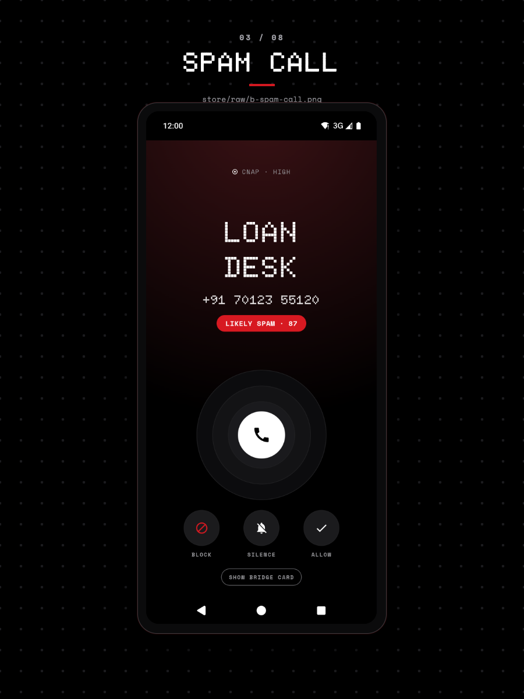

# Tune what CallGuard blocks

You set how unknown callers, spam, and non-contact texts are handled from the toggles under **PROTECTION** on the **Guard** tab. You need the call screening role granted for any call rule to run, and Contacts access for Contacts only to do anything.

Every rule lives on this one screen. The numbers themselves live in the allow and block lists, covered in [Manage the allow and block lists](../how-to/manage-lists.md).

## The controls

| Row | Default | What it does |
|---|---|---|
| **CONTACTS ONLY** | On | Blocks calls and texts from numbers that are not in your contacts. |
| **SILENCE MODE** | Off | Mutes unknown calls and unknown texts, or rejects them when **UNKNOWN CALLERS** is set to BLOCK. |
| **IGNORE MODE** | Off | Sends texts from non-contacts to the Quiet Inbox with no alert. |
| **UNKNOWN CALLERS** | SILENCE | Picks between silencing and rejecting an unknown call. |
| **BLOCK SPAM** | Off | Rejects calls scored 70 or more. |
| **SHOW CARD FOR UNKNOWN** | On | Draws the caller card over other apps for unknown numbers. |

Every setting, with its storage key and its default, is in the [settings reference](../reference/settings.md).

Silence mode is the master switch for unknown callers, and it also applies to texts even though its subtitle mentions calls only. The **UNKNOWN CALLERS** choice between SILENCE and BLOCK takes effect only while Silence mode is on, and only for a call with no contact match and no name from any source.

**BLOCK SPAM** affects calls only. A text that scores 70 or more goes to the Quiet Inbox whether the toggle is on or off.

A call that scores 70 or more arrives flagged, with the score's reasons alongside it:

## How a call is decided

CallGuard applies the rules in this order and stops at the first match:

1. Number in the block list: reject.
2. Number in the allow list: ring.
3. Contacts only, and the caller is not a contact: reject.
4. Spam score of 70 or more with **BLOCK SPAM** on: reject.
5. Spam score of 70 or more: mute.
6. Not a contact, no name, and Silence mode on: mute or reject, per **UNKNOWN CALLERS**.
7. Anything else: ring.

## How a text is decided

Texts use a different order:

1. Sender in the block list: blocked.
2. Sender in the allow list: notify normally.
3. Contacts only, and the sender is not a contact: blocked.
4. Ignore mode on and the sender is not a contact: Quiet Inbox.
5. Silence mode on and the sender is not a contact: silent notify.
6. Spam score of 70 or more: Quiet Inbox.
7. Anything else: notify normally.

## Contacts only needs Contacts access

The rule is on by default, and it cannot work without `READ_CONTACTS`. While the permission is missing, the app drops the rule before deciding, so a call is never blocked by a check it cannot run, and the row shows a **GRANT CONTACTS** pill. Tap the pill to grant.

Android forwards calls from your contacts to a third-party screening service as well, so the platform does not filter them out before the app sees them. Confirmed on API 36 with CallGuard holding `ROLE_CALL_SCREENING`: a call from a saved contact was bound to `CallGuardScreeningService` and screened, and Telecom's own record for that call carried `mIsInContacts=true`. Contacts ring because the contacts-only rule never blocks a contact, not because the platform skips them.

## When the answer arrives late

The screening service has 2500 ms (`SCREENING_DEADLINE_MILLIS`) to answer an incoming call. If name resolution and spam scoring take longer, the call is answered on the block list alone: a block-listed number is still rejected, and everything else rings. The late result is dropped, and the call log records the answer that went out. No setting changes this.

## Verify

Call your device from another phone whose number you added to the block list. The call does not ring, and the **RECENTS** row for it carries a **Blocked** tag. Call again from a saved contact with Contacts only on: it rings normally.

## Troubleshooting

- **Unknown callers still reach the phone with Silence mode on**: **UNKNOWN CALLERS** is set to SILENCE, so the call arrives without sound and stays in the call log. Set it to BLOCK to reject those calls.
- **Nothing is blocked and the screening role is held**: Contacts only does nothing without `READ_CONTACTS`. Grant Contacts access and try again.
- **A number you allow-listed was still blocked**: the block list is checked first, and a number cannot sit on both lists. See [Manage the allow and block lists](../how-to/manage-lists.md).

## Related

- [Manage the allow and block lists](../how-to/manage-lists.md)
- [Make CallGuard the default phone app](../how-to/set-as-default-dialer.md)
