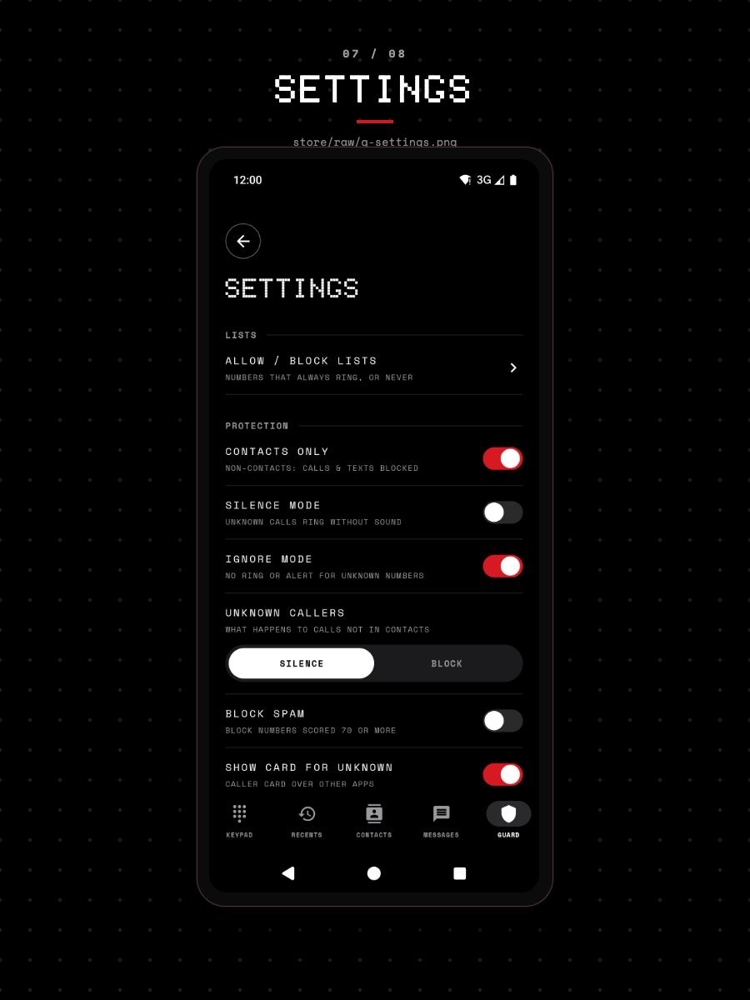

# CallGuard settings reference

Every setting CallGuard stores, with the label shown in the app, the field in `Settings`, the SharedPreferences key, the type, the default, and the behavior each value changes.

## Where settings live

All settings are one `Settings` data class (`app/src/main/java/com/callguard/prefs/Settings.kt`) persisted as primitive values in the SharedPreferences file `settings`, opened with `Context.MODE_PRIVATE` in `SettingsStore` (`app/src/main/java/com/callguard/prefs/SettingsStore.kt`).

`SettingsStore.settings` is a `StateFlow<Settings>` that every screen collects. A change through `update`, `allow`, `block` or `unlist` writes the whole record and publishes the new value, so the next call or text sees the change without a restart.

The rows live in `app/src/main/java/com/callguard/ui/screens/SettingsSections.kt` and show on the Guard tab, below the protection status. Labels in the table below are the uppercase strings that the Guard tab renders.

## Settings

| Label in the app | Field | Storage key | Type | Default | What it changes |
|---|---|---|---|---|---|
| CONTACTS ONLY | `contactsOnly` | `contactsOnly` | Boolean | `true` | Blocks calls, and texts, from numbers that are not in the phonebook, unless the text's kind rings |
| SILENCE MODE | `silenceMode` | `silenceMode` | Boolean | `false` | Silences unknown calls, and silences texts from unknown senders unless the text's kind rings |
| IGNORE MODE | `ignoreMode` | `ignoreMode` | Boolean | `false` | Sends texts from unknown senders to the quiet inbox unless the text's kind rings; no effect on calls |
| UNKNOWN CALLERS | `unknownCallerAction` | `unknownCallerAction` | Enum `UnknownCallerAction`: `SILENCE` or `BLOCK`, stored as its name | `SILENCE` | Decides whether silence mode silences or blocks an unknown call |
| BLOCK SPAM | `blockSpam` | `blockSpam` | Boolean | `false` | Blocks a call whose spam score is 70 or more, instead of silencing it |
| SHOW CARD FOR UNKNOWN | `showCardForUnknown` | `showCardForUnknown` | Boolean | `true` | Shows the caller ID card for a caller with no resolved name |
| GOOGLE CONTACTS | `googleContacts` | `googleContacts` | Boolean | `false` | Turns on the Google Contacts lookup source |
| ONLINE LOOKUP | `onlineLookup` | `onlineLookup` | Boolean | `false` | Turns on the online lookup source |
| WHATSAPP | `bridgeApps["com.whatsapp"]` | `bridgeApps` | Entry in a string set, written `com.whatsapp=true` | `true` | Reads WhatsApp call notifications and shows the overlay card |
| WHATSAPP BUSINESS | `bridgeApps["com.whatsapp.w4b"]` | `bridgeApps` | Entry in a string set, written `com.whatsapp.w4b=true` | `true` | The same for WhatsApp Business |
| ALLOW / BLOCK LISTS | `allowList` | `allowList` | String set of E.164 numbers | empty | Numbers that always ring and notify |
| ALLOW / BLOCK LISTS | `blockList` | `blockList` | String set of E.164 numbers | empty | Numbers that are always blocked |
| TEXTS THAT RING | `ringKinds` | `ringKinds` | String set of kind names, such as `OTP` | OTP, FINANCE, GOVERNMENT, TRANSACTIONAL and DELIVERY on; PERSONAL and PROMOTIONAL off | Texts of a kind that is on ring when the sender is not a contact |
| ALWAYS RING and MUTE SENDER | `senderRing` | `senderRing` | String set, each entry `key=RING` or `key=MUTE` | Empty | RING notifies every text from the sender. MUTE silences every text from it. |

The two list rows have no switch. The row opens the lists screen, and numbers reach the lists from that screen, the conversation screen, the messages screen, and the incoming-call screen. The recents screen changes spam marks instead, which is a separate record.

The TEXTS THAT RING switches are on the Guard tab. The sender actions are in the conversation sheet on the Messages tab.

## What each setting changes

### CONTACTS ONLY

When on, any number that is not in the phonebook is blocked: calls are rejected. Texts from such a number are stored, logged as blocked, and produce no alert, unless a kind in TEXTS THAT RING rings or the text looks like spam. The check runs after the allow list, so an allow-listed non-contact still rings.

The setting only applies while `READ_CONTACTS` is granted. `AppGraph.effectiveSettings()` copies the settings with `contactsOnly = false` when the permission is missing, which keeps the screening and messaging policies free of permission checks. The Guard tab shows a `GRANT CONTACTS` pill under the row in that state, and the Contacts screen shows the same request.

### SILENCE MODE

For calls, silence mode acts only on a number that is not a contact and has no resolved name. With `UNKNOWN CALLERS` set to `SILENCE` the call rings without sound; with `BLOCK` it is rejected. A contact, an allow-listed number, and any number with a resolved name are unaffected.

For texts, silence mode silences unknown senders, unless the text's kind rings. Ignore mode is checked before silence mode, so a text from an unknown sender goes to the quiet inbox when both are on.

### IGNORE MODE

Ignore mode affects texts only. A text from a number that is not a contact goes to the quiet inbox and posts no alert, unless the text's kind rings. Calls are unaffected.

### UNKNOWN CALLERS

The segmented control has two values. `SILENCE` keeps the call in the log and on the in-call screen without sound. `BLOCK` rejects it. The value is read only when silence mode is on and the caller is unknown.

The value is stored as the enum name, `SILENCE` or `BLOCK`. A stored value that does not parse falls back to `SILENCE`.

### BLOCK SPAM

Spam alone never blocks a call. With `BLOCK SPAM` off, a call scored 70 or more is silenced. With it on, the same call is rejected. The threshold is `SpamPolicy.SPAM_THRESHOLD`, `70`.

### SHOW CARD FOR UNKNOWN

This setting controls the caller ID card for incoming calls that screening handled. With it on, the card is posted for an allowed or silenced call even when no name was resolved. With it off, the card appears only when a name was resolved.

Two conditions override it. A blocked call posts a `Blocked` notice and no card. While CallGuard holds the dialer role, no card is posted at all, because the in-call screen already shows the caller.

### GOOGLE CONTACTS

Turns on `GoogleContactsSource`, which matches a number against the phonebook and then checks that the contact has a raw contact whose account type is `com.google`. It needs `READ_CONTACTS` as well as the switch; with either missing the source reports itself unavailable and returns no name.

### ONLINE LOOKUP

Turns on `OnlineLookupSource`. The source reports itself available when the switch is on, and its lookup returns no name because the app has no remote endpoint. Turning it on changes no result today.

### WHATSAPP and WHATSAPP BUSINESS

Each switch adds or removes one entry in `bridgeApps`, which maps a package name to a Boolean. `AppBridgeListener` ignores notifications from a package that is not in the map with the value `true`. The value also decides whether a name learned from that app may be used later: `AppProfileSource` reads a cached name whose origin is `app:<package>` only while the bridge is enabled for `<package>`.

### Allow list and block list

Both lists hold E.164 strings. `SettingsStore.allow` adds a number to the allow list and removes it from the block list in one update; `block` does the reverse; `unlist` removes it from both. A number is therefore on at most one list.

The allow list is checked before every other rule except the block list, so an allow-listed number rings and notifies even with contacts only and silence mode on. The block list is checked first of all, so a number that somehow reached both lists would be blocked; the store methods keep that state from being written. The lists screen, the conversation screen, the messages screen and the incoming-call screen all change the lists through the same three store methods.

### TEXTS THAT RING

Each kind of text has one switch under TEXTS THAT RING on the Guard tab. A switch that is on makes a text of that kind notify. This applies to a sender that is not a contact, when the text scores below 0.6 for spam and the number is not marked as spam. Texts from contacts notify too, unless the number is marked as spam. The app sorts each text into one kind when it arrives, and the switches do not change that sorting.

A text that scores 0.6 or more for spam goes to the quiet inbox before its kind is checked. So PROMOTIONS changes only promotions that score below 0.6. There is no SCAM switch. A scam text always scores 0.7 or more, so it always goes to the quiet inbox.

PERSONAL and PROMOTIONS are off by default. The full order is in [How CallGuard decides which texts ring](../explanation/message-filtering.md).

### ALWAYS RING and MUTE SENDER

Long-press a conversation on the Messages tab to open its sheet. ALWAYS RING notifies every text from that sender with sound. It applies even with CONTACTS ONLY on, a kind switched off, or a high spam score. MUTE SENDER silences every text from that sender, and the text stays in the inbox with no sound.

When a sender has an action, its label changes to STOP ALWAYS RINGING or UNMUTE. Tap that label to clear the setting. The block list and the allow list are still checked first.

A DLT sender ID is stored under its brand header. For example, VM-HDFCBK-S is stored as HDFCBK. So one action also covers AX-HDFCBK and other prefixes of that brand.

## Identity source rows on the Guard tab

The `IDENTITY SOURCES · ORDER` section lists eight sources in the fixed order the resolution policy uses: CNAP, Contacts, Google Contacts, Operator Service, App Profile, Cache, Bundled DB, Online Lookup. The order is not a preference. It comes from the `rank` value on `SourceKind` (`app/src/main/java/com/callguard/identity/Resolution.kt`), and nothing on the screen writes it back.

Two rows carry switches: `GOOGLE CONTACTS` (`googleContacts`) and `ONLINE LOOKUP` (`onlineLookup`). The state pills are read-only: `OPERATOR SERVICE` shows `UNAVAILABLE` because `OperatorServiceSource.isAvailable()` always returns `false`, and `BUNDLED DB v1` shows the version field of `app/src/main/assets/bundled.json`.

The other rows draw a three-bar drag handle. The handle is decoration: no drag gesture is attached, and no setting stores a source order.

## Actions on the Guard tab

| Action | What it writes | What survives |
|---|---|---|
| EXPORT LISTS & SETTINGS | One JSON file, `callguard-export-<timestamp>.json`, holding `settings` and the full data export, shared through a chooser | Everything, unchanged |
| CLEAR CACHE & LOGS | Clears the cache, both logs, and every reputation entry that is not a user mark | Lists, spam marks, settings |
| RESET ALL | The same clear, then `SettingsStore.reset()`, which clears the preferences file and restores `Settings()` | Spam marks that the user set |

The export file is written to the app's external files directory, or to the internal files directory when that is unavailable, and handed out through the `FileProvider` declared in the manifest. No storage permission is involved.

## Failure modes

- Settings can read differently from what the app does. `contactsOnly` is the only such case: it is stored as the user left it and forced off at read time when `READ_CONTACTS` is missing.
- A preferences file that cannot be read yields defaults for every key that is absent, because `load()` reads each key with the default from `Settings()`.
- `bridgeApps` is read as a string set of `package=value` pairs. When the key is absent entirely, the two WhatsApp entries default to on. When the key is present, any package missing from the set reads as off.
- `unknownCallerAction` is read with `runCatching`, so an unrecognised stored string becomes `SILENCE`.
- `allowList` and `blockList` are read as raw string sets with no normalisation at load time. A value written by an older build in another format would stay in the set and never match a normalised lookup.
- `ringKinds` and `senderRing` are read with `runCatching`. An entry that does not parse is skipped. A missing `ringKinds` key gives the six default kinds. An empty stored set stays empty, so switching every kind off is kept.

## Related

- [Permissions and roles reference](permissions-and-roles.md) for the grants these settings depend on.
- [Why screening works the way it does](../explanation/screening.md) for the order the rules are applied in.
- [Why some texts ring and others stay quiet](../explanation/message-filtering.md) for the order that the text rules apply in.
- [User Preferences domain specification](../blueprint/domains/user-preferences.md) for the product-level definition of each setting.
