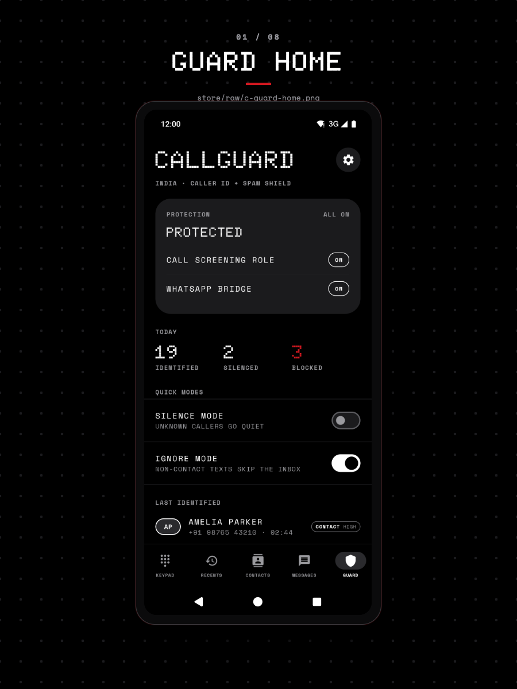

# Build CallGuard and run it on a device

You get CallGuard installed and open on a connected Android device in a few minutes, starting from a clean checkout. You need JDK 21, an Android SDK with platform 37, and a device or emulator on Android 10 or newer.

## Before you start

- JDK 21 or newer. CI pins Temurin 21, and the full gate set also runs locally on JDK 26.
- The Android SDK with platform 37 installed. The app compiles against `compileSdk = 37`.
- `adb` from the same SDK, plus a device or emulator on Android 10 (API 29) or newer with USB debugging on.

## 1. Clone the repository

```bash
git clone https://github.com/heyaibi/callguard.git
cd callguard
```

## 2. Point Gradle at JDK 21 and the SDK

```bash
export JAVA_HOME=$(/usr/libexec/java_home -v 21)
printf 'sdk.dir=%s\n' "$HOME/Library/Android/sdk" > local.properties
```

`local.properties` holds this machine's SDK path and is gitignored, so a fresh clone has none and the build stops without one. On Linux, set `JAVA_HOME` to your JDK 21 directory and `sdk.dir` to your SDK path.

## 3. Build the debug APK

```bash
./gradlew assembleDebug
```

```text
BUILD SUCCESSFUL
```

The APK is at `app/build/outputs/apk/debug/app-debug.apk`. If Gradle reports an unsupported JVM version, `JAVA_HOME` is pointing somewhere other than the 21 install you set above.

## 4. Install it on the device

```bash
adb devices
```

```text
List of devices attached
emulator-5554	device
```

```bash
adb install -r app/build/outputs/apk/debug/app-debug.apk
```

```text
Performing Streamed Install
Success
```

## 5. Launch it

```bash
adb shell am start -n com.callguard/.MainActivity
```

```text
Starting: Intent { cmp=com.callguard/.MainActivity }
```

The app opens on the Guard screen:



## Verify

The Guard screen opens with the protection card reading **3 TO SET UP**, because the call screening role, the WhatsApp bridge, and Contacts access are all still missing on a fresh install. The bottom bar shows Keypad, Recents, Messages, Contacts, and Guard. Once CallGuard holds the dialer role it opens on the keypad instead, so expect that on a second run.

## What you have now

A debug APK signed with the debug key, which is fine for testing and wrong for publishing. The app has no backend and the manifest declares no internet permission, so contacts, call history, and texts stay on the device.

## Next steps

- [Make CallGuard the default phone app](../how-to/set-as-default-dialer.md)
- [Make CallGuard the default SMS app](../how-to/set-as-default-sms-app.md)
